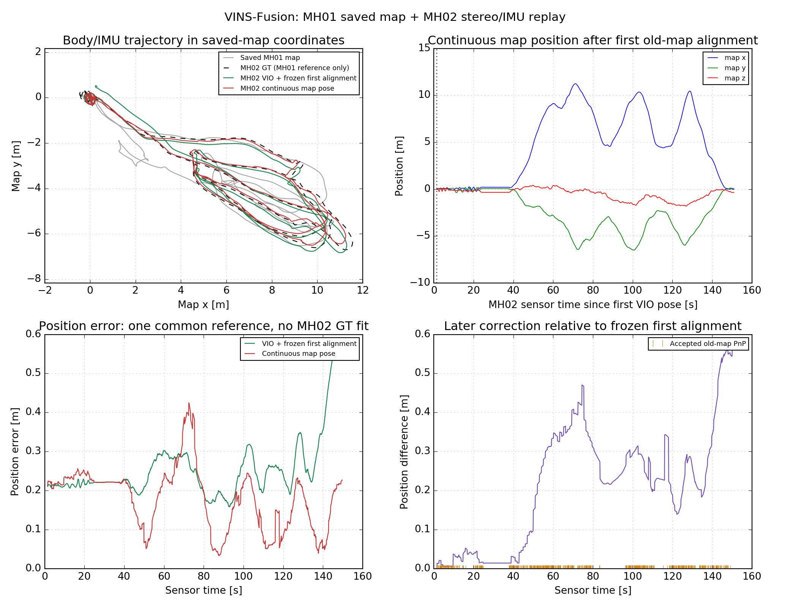

# VINS-Fusion：让 Agent 完整复现地图定位 + 双目视觉惯性定位

使用官方 VINS-Fusion 的 `vins_node` 和 `loop_fusion_node`：MH01 建图并保存，重启后加载地图，对 MH02 做图像匹配/PnP、跨序列对齐和连续地图位姿输出。固定上游提交 `be55a937a57436548ddfb1bd324bc1e9a9e828e0`；无需真实硬件、宿主 ROS 或 GPU。

## 把这段话和链接交给 Agent

> 请克隆 https://github.com/Lin-Ruipeng/vins-fusion-map-localization ，先读 README.md 和 AGENTS.md，再运行 `bash scripts/reproduce.sh`。完成 MH01 重新建图、重启加载新地图、MH02 全量跨序列定位和自动验收。请持续执行、排错，最后给出本次新运行的 summary.json、有效 PnP/对齐/连续位姿证据和轨迹图。若缺管理员授权、需要重启或网络受阻，请说明具体条件。reference_results 只是历史参考。

Agent 需要能执行终端命令、联网及调用 Docker。学生不需要懂 ROS 或定位算法。Windows 首次安装 WSL2、Docker 或重启时可能需要本人授权。

## 一条命令完整复现

```bash
git clone https://github.com/Lin-Ruipeng/vins-fusion-map-localization.git
cd vins-fusion-map-localization
bash scripts/reproduce.sh
```

入口依次完成：环境检查 → 匿名下载并校验环境镜像 → 固定源码编译 → EuRoC 下载/标定与逐条时间戳核对 → MH01 建图并用原生 `s` 保存 → 地图完整性验证 → 重启加载新地图 → MH02 定位 → CSV/rosbag 核对与轨迹评价。

每次生成唯一 ID；新地图、两个会话和日志保存在本地 `maps/`、`results/`。本次总报告是 **`results/<run-id>/summary.json`**，只有其中 `status: passed` 才表示本次完整复现通过。报告指向新 MH02 的 `verification.json`、CSV、输出 bag 和图像。

慢 CPU 可用 `bash scripts/reproduce.sh --rate 0.25`；默认 0.5 倍回放。默认总超时 120 分钟，可用 `--timeout-minutes 240` 调整。重新执行会复用已校验下载并生成新的运行 ID，保留原结果。

## 平台和首次准备

- **Linux x86_64**：Ubuntu 26.04.1 + Docker 29.1.3 为实际测试基线。
- **Windows x86_64 + WSL2 Ubuntu + Docker Desktop**：提供配置指引，尚未在 Windows 实机验证。在 WSL2 的 Linux 终端中运行，建议将仓库放在 `~/work/`。
- Apple Silicon、Windows ARM、原生 PowerShell 运行未验证。

宿主需要 Docker daemon 访问权限、Git、curl、Python >=3.8、gzip、tar、sha256sum、flock。建议 4 CPU 线程、16 GiB 内存和 40 GiB 可用磁盘；doctor 的最低资源预留是 8 GiB 可见内存、25 GiB 可用磁盘。全部 ROS/Python 2/科学计算依赖在容器内。

[平台与安装指引](docs/platforms.md) · [失败后处理](docs/troubleshooting.md)

## 从空目录验证完整入口

2026-11-01，实际从无源码缓存、数据、地图、编译产物的新 Git 克隆执行默认完整流程，全部阶段通过：**25.6 分钟、1,091 个新关键帧、MH02 1,510 对位姿、461 次旧图 PnP、位置 RMSE 0.193 m**。源码及数据重新从公开来源获取；候选环境镜像的匿名下载使用相同 SHA256 字节。详见[空目录复现记录](reference_results/clean_reproduction/README.md)、[总报告](reference_results/clean_reproduction/summary.json)和[新 MH02 验收](reference_results/clean_reproduction/mh02_verification.json)。Windows/WSL2 仍未实机验证。

## 已有实际证据

2026-11-01 的历史完整运行记录在 [`reference_results/`](reference_results/)，不作为新运行成功的依据：

| 项目 | 参考运行结果 |
|---|---|
| MH01 保存地图 | 1,091 关键帧，1,831 对局部/校正位姿；全部依赖文件校验完整 |
| MH01 同序列检查 | 独立重启后回放 30 秒，281 对位姿，正常退出 |
| MH02 跨序列 | 1,510 对位姿；461 次已加载旧图的有效 PnP；首次 50/88 内点并执行对齐 |
| 连续位姿 | 对齐后 1,495 条，数据时间 10 Hz；25.79 秒匹配空档中 128 条，含 3.40 m 位移、9.09° 姿态变化 |
| 导出核验 | CSV 和实际 bag 逐条一致；最终节点退出码全部为 0 |
| 事后位置 RMSE | 地图校正后 0.197 m，冻结首次对齐的 VIO 0.268 m；单次运行、统一参考变换 |



[原始验收 JSON](reference_results/mh02_localization/verification.json) · [连续位姿图](reference_results/mh02_localization/continuity_evidence.png) · [首次跨序列匹配](reference_results/mh02_localization/first_cross_sequence_match.png)

新运行不要求复现同样的匹配次数或误差数字。验收检查实际初始化、旧图 PnP、对齐、匹配空档中的持续输出、位姿有效性、消息一致性和正常退出。

## 发布附件与单步操作

[Release v0.1.0-euroc](https://github.com/Lin-Ruipeng/vins-fusion-map-localization/releases/tag/v0.1.0-euroc) 提供历史 MH01 地图、固定环境镜像及三次输出 bag，附 SHA256。公开下载不要求 GitHub 登录或 Token；不使用 Git LFS。完整入口只恢复环境镜像，重新建立自己的地图。

```bash
# 可选：恢复历史地图、参考输出 bag 或全部附件（均先校验 SHA256）
bash scripts/download_artifacts.sh map
bash scripts/download_artifacts.sh bags
bash scripts/download_artifacts.sh all

# 单独重编译；默认使用固定 Release 镜像
bash scripts/build.sh
# 可选：按 Dockerfile 从源码重建环境，镜像 ID 可能不同
bash scripts/build.sh --from-dockerfile

# 单独准备数据，镜像与官方来源失败时互相回退
bash scripts/download_data.sh
# 单独建新地图、加载定位；名称必须未使用
MAP_NAME=example_map bash scripts/run.sh build-map 0.5 example_mh01
python3 scripts/validate_map.py example_map
MAP_NAME=example_map bash scripts/run.sh mh02 0.5 example_mh02
bash scripts/export_and_verify.sh example_mh02
```

[附件清单及哈希](artifacts/manifest.json) · [实际环境与补丁记录](environment/BUILD_NOTES.md) · [数据来源记录](docs/data-provenance.json) · [此前方案调研](docs/notes/)

## 输出和评价口径

局部 `/vins_estimator/odometry` 与校正 `/loop_fusion/odometry_rect` 的 pose 均为 **body/IMU** 位置和四元数。相机位姿需另外乘 `body_T_cam` 外参。校正消息在首次旧图匹配前也发布，验收使用实际 PnP 和对齐事件确定有效时间。

连续输出跟随 VIO，约 10 Hz 数据时间；0.5 倍回放约为墙钟 5 Hz，不等于 200 Hz 原始 IMU。地图匹配和图优化可能造成跳变。这里只验收 pose，不把原生校正消息中的速度或协方差当作已验证融合状态。

GT 只用于事后评价：将 MH01 GT body 位置以一次 SE3、尺度 1 对齐至本次已保存 MH01 地图，再把同一个变换用于 MH02 GT；不针对 MH02 重新拟合。冻结首次对齐 VIO 的对比只使用第一次实际地图几何对齐。

本仓库验证公开数据集上的功能链路；精度不保证跨机器相同。单目、真实硬件、孤立单张照片和经纬度定位未验证。源码补丁仅增加验收日志并修复线程退出，没有修改 VIO、PnP、匹配门限或图优化算法。

## 开发检查和许可

```bash
python3 -m unittest discover -s tests -v
```

回归检查需要本机回环 HTTP 套接字权限。见 [LICENSE](LICENSE) 和 [第三方来源](THIRD_PARTY_NOTICES.md)；EuRoC 数据和第三方组件的许可单独适用。
